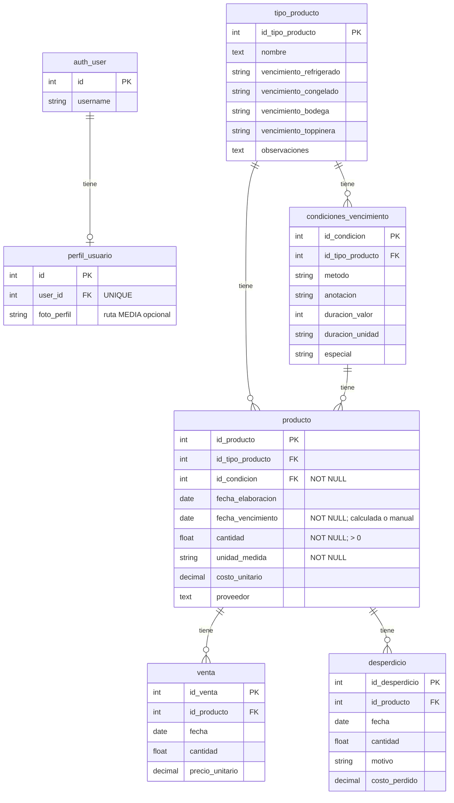

# Arquitectura — ¿Cuándo Vence?

## Estilo arquitectónico

Monolito modular con frontend y backend separados:

- **Backend**: Django 6.0.5 + DRF, **API-only** (no renderiza templates propios).
- **Frontend**: SPA React 19 + Vite + React Router, **única fuente de HTML**.
- **Base de datos**: SQLite3 (`src/backend/db/vencimientos.db`), con el catálogo de vencimientos y diez lotes ficticios de ejemplo.
- **Archivos de usuario**: las fotos de perfil se almacenan bajo `src/backend/media/`; SQLite guarda su ruta relativa.
- Comunicación solo vía **API REST en `/api/`** con autenticación por **token**.

## Topología de ejecución

### Producción / uso diario — un solo servidor

```
Browser ── http://127.0.0.1:8000/ ──▶ Django
                                        ├─ /               → index.html (build de Vite)
                                         ├─ /assets/*       → JS/CSS del build
                                         ├─ /api/*          → API REST (DRF)
                                         ├─ /media/*        → archivos de perfil (MEDIA)
                                         └─ /admin/         → admin de Django
```

- `npm run build` genera `src/frontend/dist/`; Django lo sirve vía `FRONTEND_DIST` (templates + static).
- **Un solo comando**: `python manage.py runserver` desde `src/backend`.
- La máquina del local no necesita Node ni Vite.

### Desarrollo — dos servidores (con HMR)

```
Browser ── http://localhost:5173 ──▶ Vite (HMR)
                │ /api/* (proxy)
                └──────────────────▶ Django :8000 (solo API)
```

- Vite (5173) con Hot Module Replacement; proxea `/api` a Django (ver `vite.config.js`).
- Útil mientras se desarrolla el frontend; en producción no se usa.

## Capas del backend (`src/backend/`)

```
HTTP → urls.py (controlStock)
        ├─ /api/* → Inventory/api.py → serializers.py → models.py → SQLite
        ├─ /media/* → MEDIA_ROOT (servido por Django en el modo local)
        ├─ /admin/ → Django admin (usa sus propios templates)
        └─ / (+ catch-all SPA) → controlStock/views.py → index.html del dist
```

| Archivo | Responsabilidad |
|---|---|
| `controlStock/settings.py` | Config, BD, `FRONTEND_DIST`, MEDIA, DRF (solo Token + Basic) |
| `controlStock/urls.py` | Routing raíz; catch-all SPA (excluye `/api/`, `/admin/`, `/assets/`) |
| `controlStock/views.py` | `spa` (sirve `index.html`), `favicon` |
| `Inventory/models.py` | 6 modelos + `calcular_fecha_vencimiento()`; el vencimiento se calcula solo si no se proporcionó uno |
| `Inventory/api.py` | 5 viewsets (4 de solo lectura; lotes permiten GET y POST) + `login_api`, `me` y `metricas` |
| `Inventory/serializers.py` | Tipos incluyen `condiciones`; lotes incluyen `condicion` y validan unidad/fecha al crear |
| `Inventory/admin.py` | Catálogo, lotes, ventas, desperdicios y perfil opcional de usuario |

### Modelo de datos

```
Usuario 1──0..1 PerfilUsuario
TipoProducto 1──N CondicionVencimiento
     │ 1                │ 1
     │                  │
     └────── N Producto ┘   (lote físico: tipo + condición + fechas + cantidad/unidad)
                 │ 1
                 ├──N Venta
                 └──N Desperdicio
```

Diagrama entidad-relación (generado desde los modelos Django con `src/backend/tools/gen_diagrama_er.py`; fuente: [`diagrama-er.mmd`](./diagrama-er.mmd)):



- `TipoProducto` = catálogo (nombre único). Los campos `vencimiento_*` son legacy (solo referencia); la fuente de verdad vive en `CondicionVencimiento`.
- `Producto` representa una partida física. `unidad_medida` es propia de cada lote, obligatoria y controlada (`g`, `kg`, `ml`, `l`, `unidad`, `paquete`); no se convierten cantidades entre unidades.
- `Producto.save()` calcula el vencimiento solo si no se proporcionó una fecha final. Si el usuario ingresa un vencimiento manual, `save()` lo conserva. La condición `PROVEEDOR` requiere fecha manual.
- `PerfilUsuario` es una relación opcional 1:1 con el usuario Django. `foto_perfil` es opcional; el archivo vive en MEDIA y SQLite almacena su ruta. Si no hay perfil o imagen, `/api/auth/me/` devuelve `foto_perfil: null`.
- `metricas` agrega ventas/desperdicios por producto (rendimiento, ganancia).
- El alta autenticada de lotes valida tipo/condición, fechas, cantidad y unidad; el endpoint no habilita edición ni eliminación.

### Persistencia de imágenes

- `MEDIA_ROOT = BASE_DIR / 'media'`; `MEDIA_URL = '/media/'`.
- Las fotos se guardan en `media/perfiles/`, no como bytes dentro de SQLite. Django sirve MEDIA en el modo local (`DEBUG`).
- Para trasladar el sistema se conservan tanto `vencimientos.db` como la carpeta `media/`.
- Django Admin permite cargar o quitar una foto desde el perfil del usuario; el frontend no administra las imágenes.

### Migraciones y datos de ejemplo

- `0003_producto_unidad_perfil` agrega la unidad temporalmente nullable y el perfil opcional.
- `0004_producto_campos_obligatorios` valida los lotes completos y establece unidad, condición, vencimiento y cantidad como obligatorios; también aplica restricciones de unidad permitida y cantidad positiva.
- `manage.py replace_inventory_demo --replace` reemplaza los lotes de demostración en una transacción; no es una migración y conserva el catálogo `TipoProducto`/`CondicionVencimiento`.
- La base actual contiene 93 tipos, 222 condiciones y diez lotes ficticios de ejemplo; ventas y desperdicios no tienen registros asociados.

### Autenticación

- `POST /api/auth/login/` → usuario + password → devuelve token (DRF authtoken).
- `GET /api/auth/me/` → `username`, `id` y `foto_perfil` (URL absoluta o `null`).
- `GET/POST /api/productos/` → consulta y alta de lotes; detalle con GET. No habilita PUT, PATCH ni DELETE.
- El resto de `/api/` exige `Authorization: Token <token>`.
- **Sin `SessionAuthentication` a propósito**: con frontend y backend en el mismo origen, el browser manda la cookie de sesión y DRF exigiría CSRF en `/api/` (ver «Advertencias» en [`AGENTS.md`](../../AGENTS.md)).
- `/admin/` usa sesiones de Django por su cuenta (no pasa por DRF).

## Capas del frontend (`src/frontend/`)

```
main.jsx → App.jsx (Router + layout)
            ├─ pages/       → HomePage, InventoryPage, ProductosPage, RotulosPage
            ├─ components/  → Navbar, Footer, DataCell, ProtectedRoute
            ├─ context/     → AuthContext (token + user en localStorage)
            └─ api/client.js → fetch centralizado (inyecta el token)
```

### Rutas

| URL | Página | Descripción |
|---|---|---|
| `/` | `HomePage` | Portada con login |
| `/inventario` | `InventoryPage` | Tabla de tipos de producto con buscador (protegida; asignación actual de componentes) |
| `/productos` | `ProductosPage` | Tabla de lotes con buscador (protegida; asignación actual de componentes) |
| `/rotulos` | `RotulosPage` | Carrito para armar la lista de rótulos (protegida) |

Las rutas protegidas usan `ProtectedRoute`, que redirige a `/` si no hay token en `localStorage`.

> La distribución actual de páginas/componentes conserva una inversión histórica entre el catálogo y la lista de lotes; los requerimientos por implementar especifican su asignación objetivo.

Estética: minimalista pixel art — fondo claro, tipografía monospace, detalles pixelados, logo pixel art (`src/frontend/src/assets/logo.png`).

### Flujos principales

1. **Login**: `HomePage` → `POST /api/auth/login/` → `AuthContext.login()` guarda `{token, user}` en `localStorage` → navega a `/inventario`.
2. **Consulta de tipos**: `InventoryPage` → `GET /api/tipos/?search=` → catálogo con condiciones.
3. **Consulta de lotes**: `ProductosPage` → `GET /api/productos/?search=` → filas de lotes del local.
4. **Alta de lote (backend)**: `POST /api/productos/` autenticado → valida condición, fecha final, cantidad y unidad → conserva el vencimiento manual o calcula si no se envía.
5. **Rótulos**: `RotulosPage` → elige tipo + fecha de elaboración + condición → calcula vencimiento en el browser → "carrito" de rótulos (aún sin persistencia en backend).
6. **Logout**: `AuthContext.logout()` borra `localStorage` (client-side; no hay endpoint).

## Decisiones de arquitectura (ADRs resumidos)

1. **Eliminar el frontend MPA legacy** (templates Django `home/inventario/rotulos`, app `core`, `static/`): duplicaba al SPA y dividía la lógica en dos lugares. Django quedó API-only.
2. **Un solo servidor en producción (opción 2)**: Django sirve el build de Vite. Pensado para el uso diario en la cafetería: un proceso, un puerto, sin Node.
3. **Token auth sin sesiones en la API**: evita el conflicto CSRF del mismo origen; el admin conserva sesiones.
4. **SQLite + MEDIA**: SQLite es suficiente para un solo local con pocos usuarios concurrentes. La base y la carpeta `media/` viajan juntas cuando se traslada la aplicación.

## Restricciones y notas

- `src/backend/db/vencimientos.db` conserva el catálogo de productos/condiciones y actualmente contiene diez lotes ficticios de demostración. `replace_inventory_demo --replace` sustituye esos lotes de forma explícita; no modifica el catálogo y se niega si hay ventas/desperdicios asociados.
- Las fotos de `media/` son archivos separados de SQLite; incluir ambas ubicaciones en cualquier respaldo operativo.
- Locale `es-ar`; `CORS_ALLOW_ALL_ORIGINS = True` (solo dev).
- `dist/` está gitignoreado: en cada deploy hay que correr `npm run build`.
- Scripts de un solo uso (`tools/`): `migrar_vencimientos.py` (ya ejecutado 2026-06-24); `inspect_venc.py` solo lectura.
